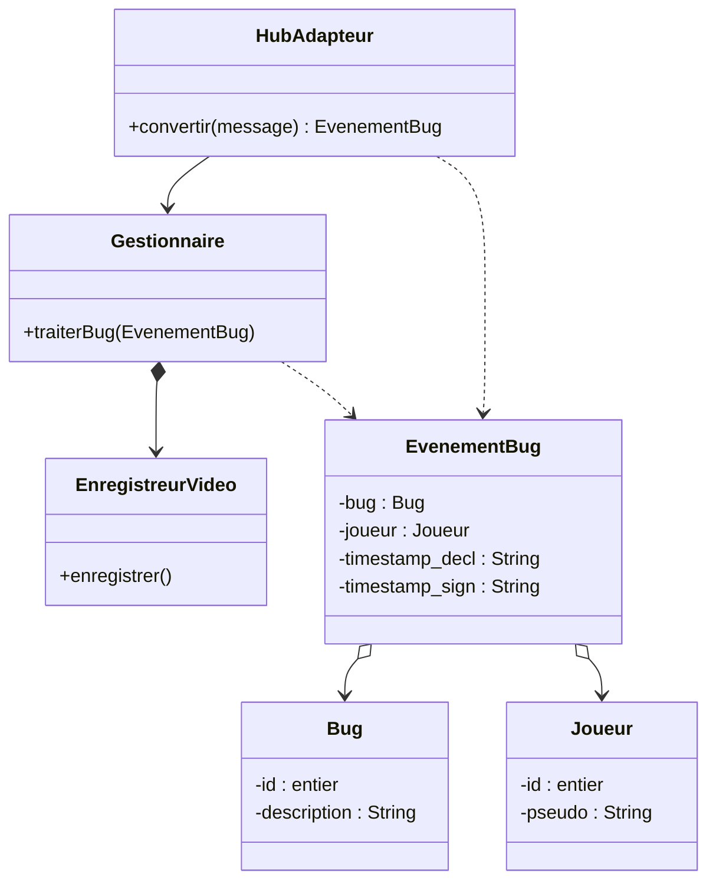

# Orion – démo v0 (projet CHPS0705, client Kapture)

Interface web minimale qui montre le fonctionnement des classes du framework Orion
sur un petit jeu de test : deviner un nombre entre 0 et 1000.

## Lancer la démo

Ouvrir `index.html` dans un navigateur (double-clic). Aucune installation nécessaire.

## Scénario à montrer

1. **Développeur** : les bugs 1 (`-1` révèle la réponse) et 2 (`1001` fait gagner) sont déjà déclarés. On peut en ajouter, les désactiver, et régler le délai avant « exploité ».
2. **Joueur** : proposer quelques nombres, puis `-1` → le bug se déclenche dans le jeu.
3. Le **Jeu** (fait par les développeurs, dans leur format) envoie lui-même un message → `HubAdapteur.convertir(message)` le traduit en `EvenementBug` → `Gestionnaire.traiterBug()` → `EnregistreurVideo.enregistrer()` sauvegarde les 5 dernières minutes.
4. Si le joueur clique sur **Signaler un bug** avant la fin du délai → `timestamp_sign` est rempli → état **reporté**.
   Sinon `timestamp_sign` reste `null` après le délai → état **exploité** (calculé à partir des timestamps, sans attribut en plus).

À l'écran : le diagramme du haut s'allume sur la classe appelée, le panneau « Objets en mémoire » montre chaque instance et ses attributs en direct, et le journal liste chaque appel de méthode.

## Organisation du code

```
index.html
css/style.css
js/journal.js              journal des appels (pour la démo)
js/orion/                  les classes du diagramme (une par fichier)
  HubAdapteur.js           pattern Adapter : convertir(message): EvenementBug
  Gestionnaire.js          traiterBug(EvenementBug)
  EnregistreurVideo.js     enregistrer()
  EvenementBug.js          bug, joueur, timestamp_decl, timestamp_sign
  Bug.js                   id, description
  Joueur.js                id, pseudo
js/externe/                hors Orion (simulé)
  JeuDevinette.js          le jeu du banc de test : contient les déclencheurs des bugs
                           et envoie le message au HubAdapteur
js/app.js                  câblage de l'interface
```

Simulé pour la démo (hors diagramme) : la vidéo (historique des actions à l'écran), le disque des clips et la base des événements (de simples listes en mémoire).

## Diagramme de classes (version retenue)


