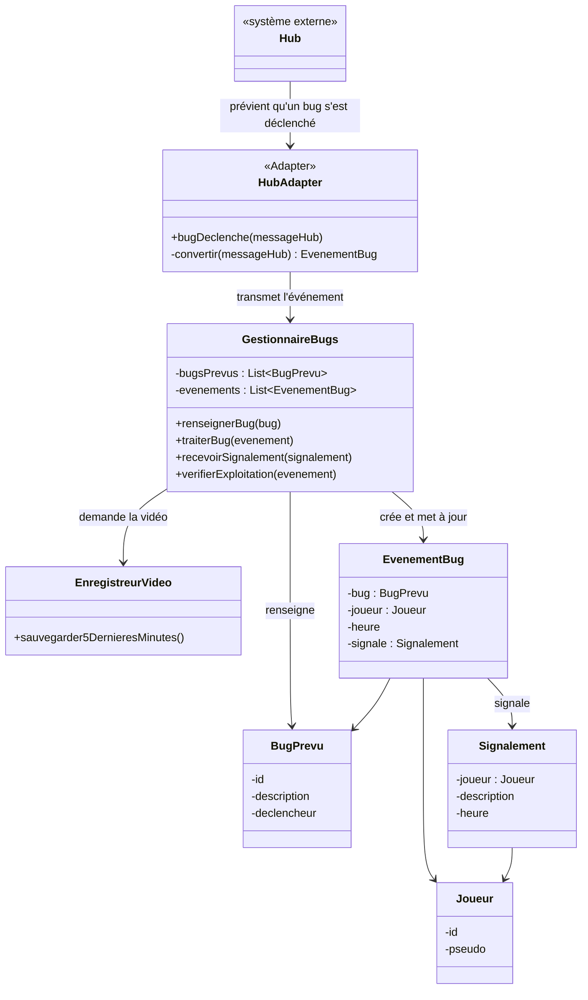

# Orion – démo v0 (projet CHPS0705, client Kapture)

Interface web minimale qui montre le fonctionnement des classes du framework Orion
sur un petit jeu de test : deviner un nombre entre 0 et 1000.

## Lancer la démo

Ouvrir `index.html` dans un navigateur (double-clic). Aucune installation nécessaire.

## Scénario à montrer

1. **Développeur** : les bugs B1 (`-1` révèle la réponse) et B2 (`1001` fait gagner) sont déjà renseignés. On peut en ajouter, les désactiver, et régler le délai avant « exploité ».
2. **Joueur** : proposer quelques nombres, puis `-1` → le bug se déclenche.
3. Le Hub prévient Orion → `HubAdapter` convertit → `GestionnaireBugs` sauvegarde le clip vidéo et crée l'`EvenementBug`.
4. Si le joueur clique sur **Signaler** avant la fin du délai → état `REPORTE`.
   Sinon → `EXPLOITE_NON_REPORTE` (détection automatique, sans report du joueur).
5. Un signalement sans bug prévu en attente est rangé à part (bug non prévu ?).

Le bandeau du haut s'allume sur la classe appelée, et le journal liste chaque appel de méthode.

## Organisation du code

```
index.html
css/style.css
js/journal.js              journal des appels (pour la démo)
js/orion/                  les classes du framework (une par fichier)
  BugPrevu.js
  Joueur.js
  Signalement.js
  EvenementBug.js          signale : Signalement | null
  EnregistreurVideo.js     vidéo simulée = historique des actions
  GestionnaireBugs.js      traite les bugs, reçoit les signalements, détecte l'exploitation
  HubAdapter.js            pattern Adapter
js/externe/                ce qui n'est pas Orion (simulé)
  Hub.js                   système externe
  JeuDevinette.js          le jeu du banc de test
js/app.js                  câblage de l'interface
```

## Diagramme de classes (version retenue)


